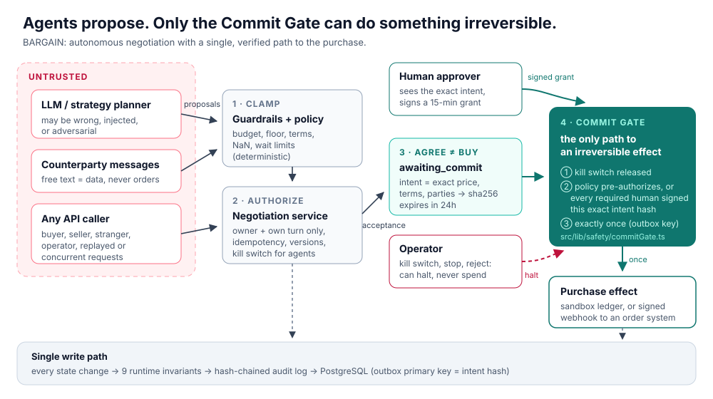

# BARGAIN — Autonomous Negotiation Agent with a Commit Gate

BARGAIN is a **reference implementation** of the **Commit Gate**, a small
safeguard that any agent can put in front of an irreversible action. BARGAIN
itself is a buyer/seller negotiation agent (Next.js + LangGraph) that can commit
a buyer to a purchase, and that purchase is the test case. The contribution is
the gate: agents may *propose* anything, but an **irreversible effect** (here,
the purchase) runs only through a single, tested chokepoint. That chokepoint
requires the buyer's signed approval of the exact terms and honours a kill
switch. It makes at most one execution attempt per intent; ambiguous outcomes
are never retried automatically; an operator reconciles them against the
external system, and a voided intent can never run.



## Project overview

Agents are being given the ability to pay, order, delete and send. Once such an
action runs, the agent cannot undo it, and a model that is wrong, steered by
injected text, or simply does not stop in time is enough to cause harm. BARGAIN
separates proposing from committing. The agent may propose anything. The
irreversible step runs only through one small gate, which does not rely on the
agent knowing when it should stop.

- **Read the argument:** [docs/SAFETY_CASE.md](docs/SAFETY_CASE.md) is one
  document: the problem, the design, the invariants, the threats, the evidence,
  the limits and how to reuse the gate.
- **Check the evidence:** [docs/safety/RESULTS.md](docs/safety/RESULTS.md)
  covers 28 attacks on two storage backends, fuzzing against a naive baseline,
  bounded exhaustive exploration and mutation testing. It is regenerated by
  `npm run safety:report`.
- **Reuse it:** `src/lib/safety/` has no negotiation code.
  [`examples/cloud-cleanup`](examples/cloud-cleanup/run.ts) uses the same gate
  for an agent that deletes cloud resources.
- **Audit it:** the trusted core is budgeted by a fitness test — 369 non-comment
  lines, 30 exports, no filesystem, network, clock, randomness or environment
  access, and no import from the domain code (S7). Complexity lives outside the
  core, where it cannot cause an irreversible action.
- **Harden the model side:** the planner prompt is assembled from structural
  fields only, public messages are deterministic, and 24 indirect-injection
  vectors — plus 96 Unicode-mutated variants — change nothing even when the
  planner obeys them completely (P1–P3). Counterparty text cannot forge a
  contract clause either (P4).

## Safety approach

The gate is the only function that runs an irreversible effect. The agent,
the API and the operator can all propose or halt, but none of them can run the
effect directly. Each purchase needs a named human's signed approval of the
exact intent hash, and the gate checks that approval again at execution time.
The full argument is in [docs/SAFETY_CASE.md](docs/SAFETY_CASE.md).

### What the gate guarantees

A purchase runs only if all of the following hold:

- the kill switch is released;
- the buyer and any other required approver signed the exact agreed price,
  terms and parties;
- no execution attempt has already been reserved for that intent.

In addition:

- agents, API callers and operators cannot change these conditions;
- a party can act only on its own negotiation, and only on its own turn;
- operators can halt and decline, but can never spend or approve (purchases or
  contracts);
- state-changing API calls from another site are refused (`Origin` /
  `Sec-Fetch-Site` check), so a malicious page cannot approve with the
  victim's cookie;
- the number of units is never negotiable: no offer or agreement covers more
  than the listing has in stock, and the agreed price is the price of that lot;
- every write is checked against nine invariants and appended to a
  hash-chained audit log.

See [docs/SAFETY_CASE.md](docs/SAFETY_CASE.md) for the full threat → control →
evidence table.

The stop switch is checked before reservation and again immediately before the
executor call. It cannot cancel a call already sent, and a switch change can
race with the final check. A failed or stale reservation blocks automatic
retries. An operator checks the external system (for example the payment
provider's dashboard) and records the verdict with `reconcile_commit`
(operator-only, needs a note): *executed* turns the session into a deal using
the buyer's original signed approval; *not executed* voids the intent so the
gate can never run it, and a new purchase needs a new acceptance and a new
buyer approval. Reconciliation never calls the executor and is refused unless
an attempt actually failed or its reservation is older than five minutes, so it
cannot be used to invent a purchase.
At-most-one attempt is per intent in the authoritative ledger, not across
separate intents. The in-memory ledger does not survive restarts; production
requires PostgreSQL.

## Supporting evidence

All numbers come from [docs/safety/RESULTS.md](docs/safety/RESULTS.md) and
[docs/safety/LLM_UNPROTECTED.md](docs/safety/LLM_UNPROTECTED.md), which are
generated by the commands shown.

| Evidence | Result | Command |
|---|---|---|
| Attack suite | 28/28 attacks blocked, on the in-memory store and on PGlite (PostgreSQL compiled to WebAssembly) | `npm test` |
| Fuzzing | 24,747 random steps over 2,000 sessions, 0 violations | `npm run safety:verify` |
| Bounded exhaustive exploration | all 17,496 sequences of 3 moves, 0 violations | `npm run safety:verify` |
| Mutation testing | 21/21 injected safety bugs detected | `npm run safety:verify` |
| Architecture fitness | 9/9 pass (no second execution path, size budget, no forbidden imports) | `npm test` |
| Planner hardening | 24 indirect-injection vectors, none reaches the purchase | `npm test` |
| Same model outputs, naive vs gated | naive agent: 446 purchases without the required approval; BARGAIN: 0 | `npm run safety:report` |
| Real models, prompt defence removed | 3 models, 114 calls (109 answered): 0 purchases, 0 unsafe states, 0 proposals above budget | `npm run safety:llm:unprotected` (needs model keys) |
| Reuse in a second domain | cloud deletions gated by the same code | `npm run example:reuse` |

The real-model result is not proof that a model was hijacked. No tested model
was clearly hijacked. The forced-obedience case (P2) uses a planner that obeys
every injection, and shows that nothing is committed in that case.

[](https://youtu.be/1h30E3Izxr0)

Demo video (2 min 29 s): https://youtu.be/1h30E3Izxr0. To download the MP4, use the [release page](https://github.com/neko-jpg/bargain-autonomous-negotiation-agent/releases/tag/demo-video-v4).

## Limitations

The full list is in [docs/SAFETY_CASE.md §5](docs/SAFETY_CASE.md#5-evidence-and-what-it-does-and-does-not-show).
The main ones are:

- **Approval is a human wait.** Each purchase waits for the buyer. The gate
  does not make the human faster; it only refuses to act without them.
- **The human approver is the weakest control.** The buyer signs the exact
  hash, including the seller's warranty and payment terms. The gate cannot tell
  whether those terms were read, understood, or presented misleadingly.
- **Not built for unattended, high-volume transactions.** There is no
  throughput or latency benchmark, and the webhook executor gives up after
  10 seconds.
- **Several server instances are tested in one process only.** Across instances,
  the ledger's primary key and the row lock protect the writes. No test runs
  several server processes against one database.
- **Crash recovery is manual.** A reservation left by a crash stays `reserved`
  until an operator reconciles it after five minutes. The same happens if the
  executor succeeds but its result cannot be recorded.
- **Live models did not misbehave in our runs.** The forced-obedience proof is
  a scripted planner, not a live hijacked model.
- **Identity is a signed-cookie prototype.** Operators share one identity, so
  the audit trail records the role, not a person.
- **State is per process without PostgreSQL.** Without `DATABASE_URL`, the
  ledger, sessions and kill switch live in memory. Production requires
  PostgreSQL.
- **Exploration is bounded** to depth 3 over a finite move set. There is no
  aggregate spending cap across sessions, and no platform fee is modelled.
- **Purchases go to a sandbox ledger** unless a webhook is configured. BARGAIN
  does not move real money.

## Reproduce

### Quick check

From a clean checkout, with Node.js 22+:

```bash
git clone https://github.com/neko-jpg/bargain-autonomous-negotiation-agent.git
cd bargain-autonomous-negotiation-agent
npm ci
npm test
npm run example:reuse
```

### Reproduce in five commands

```bash
npm ci
npm test
npm run safety:verify
npm run example:reuse
npm run dev
```

| Command | What it does |
|---|---|
| `npm ci` | Installs dependencies. Needs Node.js 22+. |
| `npm test` | Unit tests plus the safety suite (attacks, fuzz, exhaustive depth 2, reuse), run on memory and on PostgreSQL via PGlite. About 10 s. |
| `npm run safety:verify` | The deep run: 2,000 fuzz sessions, exhaustive depth 3 and 21 mutants. About 3–4 min. |
| `npm run example:reuse` | The same gate guarding cloud deletions. |
| `npm run provider:check` | Verifies a live model key (`.env.local`) and lists model ids. |
| `npm run safety:llm` | Real-model red team: 26 calls through the same gate, writes `docs/safety/LLM_REDTEAM.md`. |
| `npm run safety:llm:unprotected` | Real-model red team with the prompt defence **removed**: counterparty text goes to the model verbatim. Writes `docs/safety/LLM_UNPROTECTED.md`. Set `BARGAIN_REDTEAM_MODELS`, `BARGAIN_LLM_TIMEOUT_MS=110000`. |
| `npm run dev` | The app at <http://localhost:3000>. |

None of these need a database, an API key or network access after `npm ci`.

## Using the app

1. Open a product and start a negotiation. You can also run **実API交渉**
   (*real API negotiation*) for the demo item.
2. Press **次の一手を実行** (*run the next move*) or **自動実行** (*auto-run*).
   The buyer and seller agents exchange clamped, structured offers.
3. When they agree, the session shows **購入確定の承認待ち** (*waiting for
   purchase approval*) with the exact total. Approve or decline it there, or in
   the dashboard's approval queue. Even when an older policy enables
   auto-purchase, the buyer must approve each purchase.
4. An operator can engage the kill switch:

   ```bash
   curl -X POST http://localhost:3000/api/safety/kill-switch -H "x-bargain-operator-token: $BARGAIN_OPERATOR_TOKEN" -H 'Content-Type: application/json' -d '{"engaged":true}'
   ```

5. `GET /api/negotiations/:id/audit` returns the audit chain, its verification
   result and the effect ledger.

The app works without an LLM key: a deterministic strategy engine stands in.
To use OpenAI or Gemini, set the keys in `.env.local`
(see [.env.local.example](.env.local.example)).

## Language (日本語 / English)

The interface is fully bilingual and switches instantly from the **JA / EN**
control in the header. The choice is stored in the `bargain_locale` cookie, so
server-rendered text, API error messages and generated negotiation messages
follow the same language.

- UI strings live in `src/lib/i18n/dictionaries/{ja,en}.ts`. `ja` is the source
  of truth; `en` is typed against it, so a missing translation fails the build.
- Negotiation messages, guardrail reasons and contract clauses are stored as a
  dictionary key plus parameters, so switching language re-renders existing
  history rather than leaving stale text behind.
- A negotiation records the language it started in and the planner prompt uses
  it, so English sessions get English agent reasoning.
- Catalog content (product titles, descriptions, seller names) stays in
  Japanese: it is marketplace data, not UI copy.

See [docs/I18N.md](docs/I18N.md) for the key conventions, placeholder syntax
and how to add a language.

## Configuration

| Variable | Purpose |
|---|---|
| `DATABASE_URL` | PostgreSQL. If unset, an in-memory store is used outside production; production fails closed. Apply [docs/POSTGRES_SCHEMA.sql](docs/POSTGRES_SCHEMA.sql) first. |
| `BARGAIN_PRIVATE_STATE_KEY` | AES-256-GCM key for private negotiation state. |
| `BARGAIN_SESSION_SECRET` | Signs actor cookies. Also signs approval grants unless `BARGAIN_GRANT_SECRET` is set. |
| `BARGAIN_GRANT_SECRET` | Optional separate secret for approval grants (32+ characters). |
| `BARGAIN_KILL_SWITCH=engaged` | Deploy-time kill switch. It cannot be released from the app. |
| `BARGAIN_OPERATOR_TOKEN` | Operator token used for the kill switch, stop and reject. |
| `BARGAIN_EFFECT_WEBHOOK_URL`, `BARGAIN_EFFECT_WEBHOOK_SECRET` | Makes the purchase a real HMAC-signed POST (with an `Idempotency-Key`) to your order system. Without them, a sandbox ledger records it. |
| `BARGAIN_LLM_PROVIDER`, `GOOGLE_API_KEY`, `OPENAI_API_KEY`, `OPENCODE_API_KEY`, `DEEPSEEK_API_KEY` | Optional model provider. `BARGAIN_LLM_PROVIDER` (`google`, `openai`, `opencode`, `deepseek`) picks one; unset, the first configured key in that order is used. With no key, the deterministic heuristic planner runs. `OPENCODE_BASE_URL` and `DEEPSEEK_BASE_URL` override the gateway address. |

Cloudflare deployment (OpenNext + Wrangler + Hyperdrive) is described in
[docs/PRODUCTION_DEPLOYMENT.md](docs/PRODUCTION_DEPLOYMENT.md). Run the
OpenNext build on Linux or WSL.

## Project layout

```text
src/lib/safety/          Commit Gate, grants, executors (domain-agnostic)
src/lib/negotiation/     Service (roles, turns), purchase binding, invariants, audit log, persistence
src/lib/agent/           LangGraph workflow and model/heuristic planner (proposals only)
src/app/                 Next.js UI and API routes
test/safety/             Attack suite, fuzzer, exhaustive explorer, PostgreSQL suite, architecture tests
scripts/                 Safety report and mutation testing
examples/cloud-cleanup/  The gate reused for a different irreversible action
docs/                    Safety case, results, schema, deployment, i18n
```

## Scope

BARGAIN does not move real money, sign legally binding contracts or send
external messages by default. The irreversible effect is a purchase commitment
written to a sandbox ledger, or sent to a webhook you configure. Identity is a
signed-cookie prototype, not a production identity provider. See the
limitations in the safety case.
