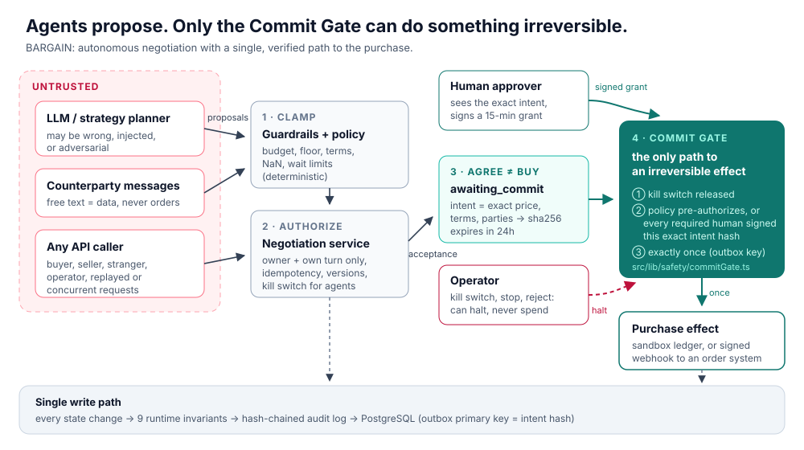

# Safety case: preventing irreversible autonomous actions

BARGAIN is an autonomous negotiation agent that can commit a buyer to a
purchase. This document is the whole argument for why it cannot do so unsafely:
the problem, the one mechanism that addresses it, the invariants it keeps, the
evidence, how to reproduce it, and how to reuse it elsewhere.



**Claim.** A purchase (the irreversible effect) is executed only if all three hold:

1. the kill switch is released;
2. the exact agreed price, terms and parties were either pre-authorized by the
   buyer's (and seller's) deterministic policy, or signed by every human that
   policy requires; and
3. that exact purchase has not been executed before.

No model output, API caller, operator, replayed request or race can change
this. Everything below supports this claim, and `npm run safety:verify`
re-checks it.

---

## 1. Why this problem is real

- **Agents are getting the ability to act.** Paying, ordering, signing,
  deleting and sending are being wired to LLM agents. Once done, these actions
  cannot be undone by the agent.
- **The model is not a trustworthy gatekeeper.** It can be wrong about
  numbers, it can be steered by text it reads, and in a negotiation the
  counterparty writes part of that text. OWASP's *Top 10 for LLM Applications*
  lists both prompt injection and excessive agency as core risks.
- **Ordinary bugs are the other half.** A code review of the original BARGAIN
  found that the buyer could accept *on the seller's behalf* from the normal
  UI, and that the human-approval path always failed in PostgreSQL. Neither was
  caught by its tests, which ran in memory only. Safety that lives in a prompt
  or a button does not hold. It has to be structural, and it has to be tested
  on the real storage.
- **Measured here.** We drove the agent with adversarial "model" outputs and
  scored each output twice: once as a naive agent that executes what the model
  says, and once as what BARGAIN actually did (see [RESULTS.md](safety/RESULTS.md#same-model-with-and-without-the-gate)).
  The naive agent would have overspent the budget, undercut the seller's floor,
  sent garbage numbers, and committed purchases that required a human. BARGAIN
  did none of these.

## 2. Design

The design separates **proposing** from **committing**.

| Stage | What it does | Where |
|---|---|---|
| 1 · Clamp | Deterministic guardrails and policy clamp every proposal: buyer budget (price + shipping), seller floor (cost + minimum profit), currency, tax, delivery, payment terms, NaN and wait limits. | `src/lib/engine/guardrails.ts`, `src/lib/negotiation/policyEngine.ts` |
| 2 · Authorize | Only the authenticated owner can act, and only on **its own turn** for offers and acceptances. Operators and the system can pause, stop and reject, but they can never author an offer or approve spending. Every request is idempotent and version-checked. | `src/lib/negotiation/service.ts` (`ACTOR_RULES`) |
| 3 · Agree ≠ buy | An acceptance does not buy anything. It moves the session to `awaiting_commit` with an **intent**: the exact price, terms, parties and accepted offer, hashed with SHA-256 and set to expire. | `src/lib/negotiation/commit.ts` |
| 4 · Commit Gate | The only function that runs an irreversible effect. It checks, in this order: the intent is authorized, it is not a duplicate, the kill switch is released. It then reserves the intent in an outbox ledger (one row per intent hash) and runs the effect once. | `src/lib/safety/commitGate.ts` |

**Who must approve** is decided by policy, never by the model.
`buyerCommitApprovalReason` requires the buyer's signature when auto-purchase is
off, when the total exceeds the auto-approval limit, or when it exceeds the
budget. `sellerCommitApprovalReason` does the same on the seller side.

**Approvals are grants**, not flags. A grant is HMAC-signed and names one
approver, one intent hash and a 15-minute expiry. Grants are created only by
`grantPurchaseApproval`, after an authenticated party approves the exact
intent hash it was shown (`approve_commit`, or `human_accept`, which signs the
terms the human accepted). A grant cannot be forged, moved to another intent,
or used by someone else. Declining a purchase does not end the negotiation; it
pauses it so the human can counter or stop.

**Kill switch.** `BARGAIN_KILL_SWITCH=engaged` (set at deploy time, and not
releasable from the app) or the operator toggle (`POST /api/safety/kill-switch`)
halts agent steps and makes the gate refuse every new effect. Agreements reached
while it is engaged wait in `awaiting_commit`, and `retry_commit` runs them
after release.

**Defense in depth on storage.** Every state change goes through one function,
`commitPersistedSession`. It checks the eight invariants below and appends a
hash-chained audit entry in the same transaction. A bug elsewhere therefore
cannot write an unsafe state, and editing history afterwards is detectable.

**Effect executors.** The default executor records the purchase in a sandbox
ledger. Setting `BARGAIN_EFFECT_WEBHOOK_URL` and `BARGAIN_EFFECT_WEBHOOK_SECRET`
makes the effect a real external call: an HMAC-signed POST with an
`Idempotency-Key` equal to the intent hash, sent to an order or payment system.

## 3. Invariants

| ID | Invariant | Enforced by | Checked by |
|---|---|---|---|
| INV-01 | A session in `deal` or `rejected` never changes again. | service status rules + write-path monitor | A19, explorer, fuzz |
| INV-02 | Offer history is append-only. | write-path monitor | explorer, fuzz |
| INV-03 | No new buyer-side offer, and no agreement by either side, exceeds the buyer's current budget or the listing price. | guardrails, policy engine, offer withdrawal, monitor | A07, A09, A23, fuzz, mutants M10, M17 |
| INV-04 | No new seller-side offer, and no agreement by either side, is below the seller's current effective floor. | guardrails, policy engine, monitor | fuzz, explorer |
| INV-05 | A human offer speaks only for the authenticated party that wrote it; operators and the system never author offers. | service `ACTOR_RULES`, monitor | A01, A02, A03, A05, explorer |
| INV-06 | `deal` is reachable only from `awaiting_commit`, with a receipt whose intent hash matches the pending intent and is executed in the ledger. | gate + monitor | A16, R2, fuzz, explorer |
| INV-07 | A pending intent always hashes to its recorded hash and comes from the latest acceptance. | commit binding + monitor | A06, A08, A13 |
| INV-08 | While the kill switch is engaged, no agent offer is written and no new effect runs. | service + gate + monitor | A15, explorer |

## 4. Threats, controls and evidence

| Threat | Control | Evidence |
|---|---|---|
| A party acts for the other side (the review bypass) | own-turn binding, approver-specific grants | A01, A02, mutants M01, M11 |
| A user, seller or operator exceeds their role | `ACTOR_RULES`, ownership check | A03, A04, A05, mutants M02, M16 |
| The model overspends, undercuts or emits garbage | clamps + monitor | A07, fuzz (naive vs gated), mutant M10 |
| The model misreports a price to dodge approval | the intent is built from the accepted offer, not from model text | A08 |
| Prompt injection via counterparty text | text is data; budgets and the gate do not read it | A09 |
| Stale or substituted approval | intent-hash binding, expiry | A06, A13, A14, mutants M05, M12, M13 |
| Forged approval | HMAC grants | A12, mutant M04 |
| Replay or concurrent double approval | idempotency keys, session lock, outbox primary key | A10, A11, A22, R4, mutant M06 |
| Runaway agent | kill switch (environment and operator) | A15, mutants M07, M08 |
| A bug writes an unsafe state directly | invariant monitor on the single write path | A16, A19, mutant M09 |
| History is rewritten to hide an action | hash-chained audit log | A17, R3, mutant M14 |
| A stale offer is accepted | latest-proposal rule | A18, mutant M15 |
| An offer made under an older, higher budget is accepted after the buyer lowers it (**found by our own fuzzer**) | offers bind only while they fit their author's current policy (`isOfferStillBinding`), plus the monitor checks every agreement against both current policies | A23, mutant M17 |
| Bugs that appear only with the real database | the same suite runs on PostgreSQL (PGlite) | R1–R5 and A01–A23 on PostgreSQL |
| A future change adds a second path to the effect | architecture fitness tests | S1–S6 |

## 5. Evidence and what it does and does not show

The current numbers are in **[docs/safety/RESULTS.md](safety/RESULTS.md)**, which is generated by
`npm run safety:report`.

- **Attack suite.** 23 named attacks, each run on the in-memory store and on
  PostgreSQL.
- **Fuzzing.** Seeded random sequences of honest and hostile actions by five
  kinds of actor, driven by six adversarial planners. Independent oracles are
  checked after every step, and every output is compared with a naive baseline.
  The fuzzer **found a real bug in the new code**:

  1. the buyer offered ¥64,500;
  2. the buyer then lowered its budget to ¥63,600;
  3. the seller accepted the old offer.

  The gate still asked the buyer for approval, so nothing was bought silently.
  But the claim "never commit above the current budget" no longer held. The
  fix withdraws offers that no longer fit their author's policy. It also
  extends INV-03 and INV-04 to every agreement. Attack A23 and mutant M17 keep
  the bug from coming back.
- **Bounded exhaustive exploration.** Every sequence of 3 moves, from an
  18-move alphabet of honest and hostile moves, run from 3 start states against
  the real service, store and gate. Within that bound this is exhaustive. It is
  not a proof for unbounded sequences.
- **Mutation testing.** 17 realistic safety bugs are injected one at a time,
  including the bypass from the review and the bug the fuzzer found. A control
  copy must pass first. The suite must then fail on a named check for each
  mutant, which shows the tests are not vacuous.
- **Architecture fitness.** These tests fail the build if a second call site
  executes effects, if agent code can reach approvals, storage or the kill
  switch, if a mutating route skips authentication, or if a test hook works in
  production.

**Limits, stated plainly.**

- Exploration is bounded (depth 3, finite alphabet). Fuzzing samples beyond
  that bound but cannot cover it.
- The gate guarantees *authorization*, not wisdom: a human can still approve a
  bad deal. Policy limits bound how bad it can be.
- With the webhook executor, delivery to the receiver is at-least-once if the
  process dies between the call and the ledger update. The `Idempotency-Key`
  lets the receiver de-duplicate; BARGAIN never re-runs an effect it recorded
  as executed.
- Identity is a signed cookie prototype, not a production identity provider.
  The seller role is reachable only in demo mode, and catalog sellers are
  simulated with `autoAccept` on; seller-side approvals are implemented and
  tested.
- Model *quality* is out of scope. The safety properties hold whatever the
  model outputs.

## 6. Reproduce

```bash
npm ci
npm test
npm run safety:verify
npm run example:reuse
npm run dev
```

| Command | What it does | Approx. time |
|---|---|---|
| `npm test` | unit tests, attack suite (memory and PostgreSQL), fuzz (150 sessions), exhaustive depth 2, reuse example | ~10 s |
| `npm run safety:verify` | fuzz (2,000 sessions), exhaustive depth 3, 17 mutants | ~3–4 min |
| `npm run safety:report` | the same, and rewrites `docs/safety/RESULTS.md` and `results.json` | ~3–4 min |
| `npm run example:reuse` | the same gate guarding cloud resource deletion | ~1 s |
| `npm run dev` | the app at <http://localhost:3000>; no API key or database needed | — |

No database, API key or network is needed. PostgreSQL tests run on PGlite, a
real PostgreSQL compiled to WebAssembly. The fuzz seed is fixed, so runs are
deterministic.

## 7. Reuse the gate in another agent

`src/lib/safety/` has no negotiation code and no dependencies beyond
`node:crypto`. [`examples/cloud-cleanup/run.ts`](../examples/cloud-cleanup/run.ts)
uses it unchanged for an infrastructure agent that deletes cloud resources.
There are four steps:

```ts
// 1. Describe the effect. Everything the executor acts on is hashed.
const intent = { kind: 'cloud.delete', subjectId: id, amount: cost, currency: 'USD/month', payload: { resourceId: id } };

// 2. Decide who must approve, deterministically (never ask the model).
const requirement = isEphemeral(resource)
  ? { mode: 'policy', policyId: 'ephemeral-older-than-7-days', reason: '…' }
  : { mode: 'human', approvers: [{ id: resource.owner, role: 'owner', reason: '…' }], reason: '…' };

// 3. Make this the only call that performs the effect.
await executeIrreversibleEffect(intent, requirement, grants, { ledger, executor, isKillSwitchEngaged, secret });

// 4. Create grants only from an authenticated approval UI that showed the exact intent.
const grant = issueApprovalGrant({ intentHash: hashIntent(intent), approverId, approverRole: 'owner', ttlMs: 15 * 60_000, secret });
```

You provide three things:

- a **ledger**: `MemoryEffectLedger`, or a database table whose primary key
  is the intent hash, like `PostgresEffectLedger`;
- an **executor**: the function that performs the effect;
- an **approval surface**.

Then copy `test/safety/architecture.test.ts` to keep the gate the only path.

## 8. Where to look first

1. `src/lib/safety/commitGate.ts`: the gate (about 300 lines).
2. `src/lib/negotiation/service.ts`: `ACTOR_RULES` and the one call to
   `executeIrreversibleEffect`.
3. `test/safety/attacks.test.ts`: each attack, readable as a scenario.
